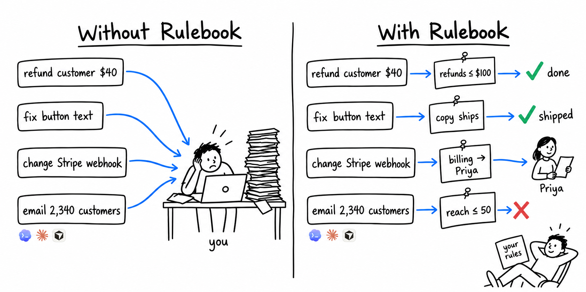

<p align="center">
  
</p>

<h2 align="center">The accountability layer for agentic work</h2>

<p align="center">
  <a href="https://github.com/Hybrid-Software/rulebook/actions/workflows/test.yml"></a>
  <a href="LICENSE"></a>
  = 20">
</p>

<p align="center">
  <a href="#your-instructions-become-rules">Quickstart</a> ·
  <a href="docs/FORMAT.md">Format</a> ·
  <a href="docs/ARCHITECTURE.md">Architecture</a> ·
  <a href="examples/">Examples</a> ·
  <a href="https://hybridapp.io">Hybrid</a>
</p>

<br>

Agents follow instructions until *they don't*.

Today, agents can do *anything*, but have no *accountability* when they're wrong. At scale, that's a liability with two bad options: either you review everything an agent does, or stop reviewing and hope nothing goes wrong.

Rulebook solves this by turning the instructions that matter into rules your agents *can't skip*. Each rule connects to a part of your business, has an owner, and fires whenever a change touches that part.

<br>

<p align="center"></p>

**Without Rulebook**, every change goes to you for review. Your instructions are suggestions, and you remain the final gate.

**With Rulebook**, your rules are verified and enforced on every change. Work they cover is approved, work they reserve goes to the rule's owner, and work that breaks a rule is blocked. You only see what needs you.

---

## Your instructions become rules

```
$ npx @hybrid-software/rulebook init

16 sentences in your CLAUDE.md already read like rules. Say which are, and who owns each:
CLAUDE.md   → priya   Anything touching billing or a data repair over real records needs Priya's nod.
CLAUDE.md             Never write to production from a script, a test, or a "quick fix".
CLAUDE.md             A live payments key never exists outside production.
…
7 draft rules written to .hybrid/rules/. Nothing is enforced until you approve one.
```

Then the next change your agent makes meets them:

```
$ npx @hybrid-software/rulebook check --base main
change   2 files · entities: billing
rule     billing-needs-priya              require priya
verdict  needs Priya — functions/stripe/webhooks.ts · evidence attached
```

And every agent on the team starts from them: `rulebook context entity:billing` at session start prints the constitution and everything attached to what the agent is about to touch. Same ids for what it was told and what it is judged by.

## What would it have caught?

```
npx @hybrid-software/rulebook init      # drafts entities and rules from your repo, CODEOWNERS, lint config and CLAUDE.md
npx @hybrid-software/rulebook replay 30 # runs them over your last 30 merges

  0 would have shipped with nobody looking
 22 would have gone to a named person (22 engineer) · 22 because no rule covers the area yet
  8 would have been held: too much in one change
```

Zero on day one is correct. Nothing ships alone until an owner switches a rule to `allow`. Approve one ("docs and copy ship") and run it again; the number moves, and every row says why. On a production fintech app we run, the first afternoon went 0 → 8 → 14 → 17 of 50 as rules were switched on, with the other 33 going to a named person with the rule that sent them there.

Nothing leaves your machine. No account.

## What a rule is

One Markdown file with a YAML header. The body is the sentence people read.

```yaml
---
id: rule:figures-match-the-dashboard
kind: rule
revision: v1
status: approved
title: Every figure the assistant states equals the dashboard's for the same user
owner: person:maya
ratifiedBy: person:maya
ratifiedAt: 2026-10-20
asOf: 2026-10-20
applies_to: [entity:budget, entity:assistant]
check:
  when: invariant
  equals: { assistant_spend_this_month: dashboard_spend_this_month }
effect:
  block: true
---
Right arithmetic over the wrong inputs looked fine in every code review for six weeks. The number is the check.
```

Three effects: `allow` (ships with nobody looking), `require: [who]` (goes to that person, with the evidence), `block`. Who answers for an agent's change? The owner of the rule it passed. That is what the `owner` field is for. Four kinds of check: `always` (fires whenever the entity is touched), `manual` (asks the owner a question, on the card), `invariant` / `outcome_changed` (a measured figure, before and after), and `uses:` (runs the checks you already have: your tests, your lint, Semgrep). A rule can carry `scope.paths` so it exists before the map does.

## For a company, not only a repo

The Rulebook doesn't store your data. It writes down the rules and judgment that live in people's heads, what the things in your business are, what was decided about them, and what has to stay true, so your agents operate under the same guardrails your employees do. Every agent reads one record; every change, a PR, a pricing decision, an email about to go out, is checked against the same rules with the same owners. Where a number lives, the record points; it never copies. Start from one rule, not a model of everything: `examples/company` is a whole company in eleven files.

## Where rules come from

Nobody writes them from a blank page. `init` reads your repo's layout, CODEOWNERS, lint config and the sentences in CLAUDE.md that already read like rules ("anything touching billing needs Maya's nod" becomes a rule with `owner: person:maya`). You confirm or delete. The rest come out of the record over time: a change that reached a person because no rule covered it is a rule request with the evidence attached.

The record has four layers, all plain files:

- **Entities** — the things in your business that can change: a part of the codebase (found by paths), a product, a customer, a figure like MRR. An entity holds what the thing *means* and where its live value lives (`same_as: stripe:acct_1`); never the value.
- **Rules** — what binds, attached to entities, with an owner and an effect.
- **History** — decisions, dated and never edited; a decision that changes an earlier one `replaces` it; one that falsifies a belief carries `corrects:` with the wrong reading kept verbatim.
- **Sources** — what was said: memos, transcripts, PR bodies, the code itself. The record keeps pointers and what was learned, never copies.

A change touches entities; the rules on those entities fire; the verdict pins the revision of every rule it used, so a March audit can replay an October decision. Same ids for what an agent is told before changing something (`rulebook context entity:billing`) and what it is judged by after. **The Rulebook never stores source data; it records how to get it.**

## It is not a memory store

| | CLAUDE.md | memory store | **Rulebook** |
|---|---|---|---|
| read when | the agent decides | the agent queries | **the thing it governs is touched** |
| when ignored | nothing | nothing | **the change doesn't ship** |
| owner | — | — | **a named person, per rule** |
| holds | prose | your data | **rules, and where data lives** |

You still want a memory store, and the Rulebook points at it. This is the layer that decides; that is the layer that remembers.

## Three things it governs

1. **Changes to software, from anyone's agent.** A PR is a collection of things that changed; the rules decide. The required check on the PR is the gate. `examples/subscriptions`.
2. **A team's agents, all reading one record.** Every agent starts from the same constitution, the same rules, the same decisions and corrections. A decision one founder made is a rule the other founder's agent hits. `examples/company`: a fictional company's Rulebook, where a draft pricing decision routes to both founders and a copy change runs the roaster-confirmation check.
3. **Agents changing their own work.** An agent that proposes a change to its own prompts or harness is a third author at the same gate. Agent-initiated changes route until the rule earns `allow`; no change to a harness may lower a held-out eval.

The same evaluator extends to actions (deploy, send, publish): a proposed action instead of a diff, the same rules, a proxy that holds the token so the agent only ever asks. The format carries it today; the proxy that holds the token ships with the hosted product.

## Commands

```
rulebook init        draft a .hybrid/ from your repo (--write to create it)
rulebook validate    every entry, every reference, the indexes
rulebook check       the verdict for the current change (--base main, or --files a,b)
rulebook replay N    the last N merges through the rules: how many didn't need anyone
rulebook context X   what attaches to an entity or entry: what an agent reads first
rulebook explain R   one rule: what it says, who owns it, why it exists
```

The GitHub Action in `action/` runs `check` on every PR and posts the verdict as a status.

## What runs where

Open source, here: the format, the validator, `init`, `check`, `replay`, `context`, `explain`, the Action. Everything that needs no environment we provide: footprint, routing, mechanical blocks, your own tests and lint, `manual` questions, journeys against an environment you already have (a preview URL, localhost).

Not here: running behavioural checks in an environment we provide, the ledger of every verdict, per-rule trust that earns `allow`, routing to real people, the editor, the action proxy. That is [Hybrid](https://hybridapp.io), the hosted product this format comes from. The line is exactly: where a change has to *run* to be judged, or where memory across runs is needed.

## Status

v0.1. The format and the four footprint-level verdicts (allow, require, block, split) run on real repos today. Invariants and outcome checks evaluate when you give them evidence; the CLI reports them as *not run here* otherwise, and never pretends. `init` gets the map mostly right on a Node or PHP repo and wrong in the strict direction elsewhere; the map is where the number lives, so tell us what it got wrong.

Docs: [FORMAT.md](docs/FORMAT.md) (every field) · [ARCHITECTURE.md](docs/ARCHITECTURE.md) (one page: the four layers, the two traversals, the verdict).

Apache-2.0.
